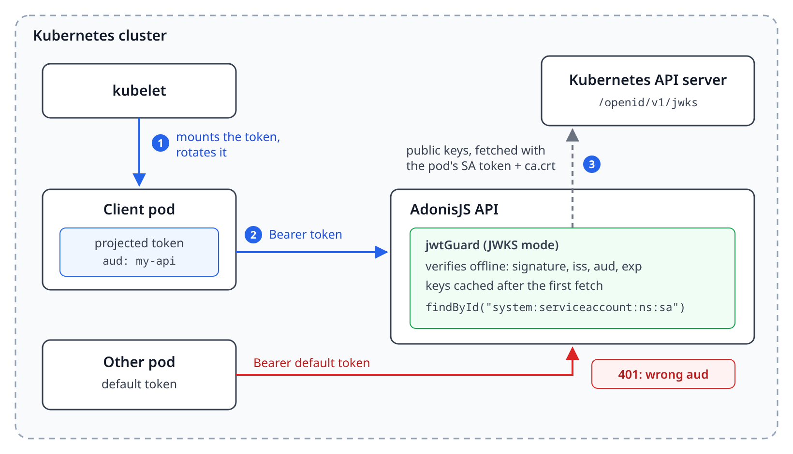

# AdonisJS Kubernetes ServiceAccount auth example

An AdonisJS v7 API that authenticates the services of a Kubernetes cluster with their ServiceAccount tokens, using [@maximemrf/adonisjs-jwt](https://github.com/MaximeMRF/adonisjs-jwt) in JWKS mode. No API key, no shared secret: the cluster signs short-lived tokens, rotates them, and the API checks them against the cluster's public keys.



## Try it in your cluster

The image is public, so there's nothing to build:

```sh
kubectl apply -k "https://github.com/MaximeMRF/adonisjs-jwt-k8s-example//k8s?ref=main"
```

This deploys the API (`my-api` in the `default` namespace) and three Jobs in a `jobs` namespace that call it:

| Job             | Token                                                             | Expected                    |
| --------------- | ----------------------------------------------------------------- | --------------------------- |
| `worker`        | projected, audience `my-api`, ServiceAccount in the allowlist     | `200 {"calledBy":"worker"}` |
| `intruder`      | projected, audience `my-api`, ServiceAccount not in the allowlist | `401`                       |
| `default-token` | the default token every pod gets, audience the API server         | `401`                       |

Each Job succeeds when it gets the status it expects:

```sh
kubectl -n jobs get jobs
kubectl -n jobs logs job/worker
```

Clean up with `kubectl delete -k "https://github.com/MaximeMRF/adonisjs-jwt-k8s-example//k8s?ref=main"`.

If your cluster isn't kubeadm or k3s, set `K8S_ISSUER` in `k8s/api.yaml` to its issuer:

```sh
kubectl get --raw /.well-known/openid-configuration
```

If the API logs `JWKS fetch failed with status 403`, its ServiceAccount isn't allowed to read the JWKS: bind `my-api` to the built-in `system:service-account-issuer-discovery` ClusterRole.

## How it works

| File                                        | What it does                                                                                              |
| ------------------------------------------- | --------------------------------------------------------------------------------------------------------- |
| `config/auth.ts`                            | The `k8s` guard: fetches the JWKS from the API server with the pod's CA and token, checks `iss` and `aud` |
| `app/auth/service_account_user_provider.ts` | The allowlist of ServiceAccounts, from the token's `sub`                                                  |
| `start/routes.ts`                           | `POST /internal/jobs`, protected by the `k8s` guard, and a public `GET /health`                           |
| `k8s/`                                      | The API and the client Jobs                                                                               |

The guard is configured with environment variables, which default to what works inside a kubeadm or k3s cluster:

| Variable       | Default                                         |
| -------------- | ----------------------------------------------- |
| `K8S_ISSUER`   | `https://kubernetes.default.svc.cluster.local`  |
| `K8S_AUDIENCE` | `my-api`                                        |
| `K8S_JWKS_URI` | `https://kubernetes.default.svc/openid/v1/jwks` |
| `K8S_SA_DIR`   | `/var/run/secrets/kubernetes.io/serviceaccount` |

`APP_KEY` isn't used by the `k8s` guard, so the image generates one at startup when it's not set.

## What it protects against, and what it doesn't

ServiceAccount tokens remove the shared secret between your services. There's no API key to leak from an environment variable or a Git repository, and no one can forge an identity without the cluster's signing key. The audience also works both ways: a token for `my-api` is rejected by the Kubernetes API server, so a compromised API can't reuse the tokens it receives to drive the cluster.

The security boundary becomes Kubernetes RBAC, and a few things stay your job:

- **A compromised pod is that service.** An attacker inside the `worker` pod reads its token and calls the API as `worker` for as long as they stay in the pod. Authorize per service, so each ServiceAccount can only call the routes it needs.
- **Whoever can get a token is that service.** Creating pods in the `jobs` namespace, `exec` into its pods, or the `create serviceaccounts/token` permission all give a `worker` token. Keep those rights tight.
- **The bearer token travels over plain HTTP.** This example calls `http://my-api.default.svc`, so anyone who can sniff the cluster's traffic sees the token. Use TLS, or a service mesh with mTLS, if that's in your threat model.
- **Keep internal routes internal.** Don't expose `/internal/*` through your ingress, and restrict who can reach the API with a NetworkPolicy. Your CNI has to enforce it.
- **Never turn off TLS verification on the JWKS fetch.** The keys are public, but someone in the middle could serve their own and sign any token.
- **Revocation isn't immediate.** Tokens are verified offline, so a token stays valid until its `exp`, even if its pod is gone. Keep `expirationSeconds` short (the minimum is 600), or call the `TokenReview` API if you need instant revocation.

You don't need an API key on top: it would bring back a secret to manage without closing any of these gaps.

## Tests

```sh
npm install
cp .env.example .env && node ace generate:key
npm test
```

The tests run without a cluster. A fake API server serves a JWKS over HTTPS with its own CA, and only to callers that send the pod's token, like the real one. It signs tokens shaped like the ones the kubelet projects. They cover: allowed ServiceAccounts, the JWKS fetched once with the pod token then cached, a ServiceAccount outside the allowlist, a default token, another audience, another issuer, an expired token, a legacy Secret-based token, a key the cluster doesn't publish, the rotated pod token, and a missing token.

`scripts/e2e.sh` runs the Jobs against a real cluster; the CI runs it in [kind](https://kind.sigs.k8s.io/) on every push.

## Read more

- [Kubernetes guide](https://maximemrf.github.io/adonisjs-jwt/guide/kubernetes) and [JWKS guide](https://maximemrf.github.io/adonisjs-jwt/guide/jwks) in the package documentation
- [@maximemrf/adonisjs-jwt](https://github.com/MaximeMRF/adonisjs-jwt)
